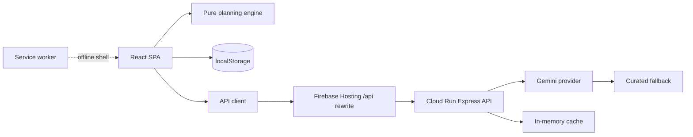

# Utsav — AI Celebration & Event Planner

## Chosen vertical
Utsav plans Indian weddings, birthdays, and community events. It combines a
rules-first planning engine with optional Gemini-powered ideas, a streaming
assistant, and plan review. The core planner works without an API key or network.

## Approach and logic
- **Rules first, AI second.** The browser computes budgets, timelines, vendor
  checklists, risks, and readiness with 23 explainable rules.
- **AI is additive.** Ideas, assistant replies, and review suggestions are
  optional. Every AI-proposed patch must be confirmed by the user and can be
  undone.
- **Local-first.** Plans autosave to `localStorage`, survive reloads, and can be
  exported or imported as JSON/CSV/ICS.
- **Predictable costs.** Budgets are allocated in whole rupees with
  largest-remainder rounding, contingency, and essential floors.
- **Inclusive by default.** English, Hindi, and Bengali dictionaries, a dark
  theme, WCAG 2.2 AA checks, and an installable offline shell.

## How it works
1. Choose an event type, sub-type, date, guests, budget, city tier, venue,
   dietary needs, priorities, and optional context.
2. The typed engine validates the context, derives season/rush state, fires
   rules, and builds an explainable plan.
3. The dashboard shows budget health, readiness, next tasks, risks, timeline,
   day-of run-of-show, and vendor checklists.
4. Mark tasks and vendor statuses as done; changes autosave and update readiness.
5. Optionally generate ideas, ask the streaming assistant, or request a plan
   review. The API falls back to curated content when Gemini is unavailable.
6. Export CSV, JSON, or calendar files, print the plan, or import a saved plan.

### Requirements → features
| Requirement | Implemented feature |
|---|---|
| Budgets | Integer allocation, contingency, floors, feasibility gap, suggestions |
| Timelines | Dependency ordering, phases, rush mode, skip list, run-of-show |
| Vendor checklists | Category selection, questions, contracts, red flags, pipeline status, Maps links |
| Logical decisions | 23 rules with IDs and plain-language effects in “Why this plan?” |
| Weddings / birthdays / community | Event types plus 14 sub-types and context-sensitive rules |
| GenAI ideas | Gemini JSON ideas with schema validation, cache, and curated fallback |
| Conversational planning | SSE streaming assistant with optional confirmed patches |
| Plan review | AI/fallback risk review with fixes |
| Persistence | Autosave, import/export, budget/due/task overrides, shortlist |
| Practical usability | INR formatting, city tiers, seasons, dietary needs, three languages |
| Installable web app | Manifest, service worker, offline shell, app icons |

## Assumptions
- The target is a responsive, installable React SPA with a small stateless
  Express API on Cloud Run; Firebase Hosting is the static edge.
- Core planning must remain fully usable offline and without Gemini.
- AI outputs are untrusted until validated by strict server schemas.
- Cloud deployment, secrets, and the GitHub remote are manual operator steps;
  this workspace contains the configuration, not live credentials.
- The repository stays on `main`, below 10 MB, with no committed secrets.

## Architecture


The client planning path has no network dependency. The API is stateless apart
from its short-lived cache and exposes `POST /api/ideas`, `POST /api/assistant`
(SSE), `POST /api/review`, and `GET /api/health`.

## Scripts
```bash
npm install
npm run dev:server   # API on :8080
npm run dev          # Vite on :5173, proxies /api
npm run verify       # full CI gate
npm run build        # client + server bundles
npm run coverage     # tests with thresholds
npm start            # serve the built API and client
```

## Testing and verification
- `npm run lint` — ESLint with zero warnings.
- `npm run coverage` — Vitest + jsdom + v8 coverage thresholds.
- `npm run build` — strict TypeScript, Vite production build, esbuild API bundle.
- `npm run check:docs`, `check:trace`, `check:size`, `check:pwa`,
  `check:repo`, `check:contrast`, `check:security`, `check:gemini`.
- `npm run verify` runs all of the above.
- `check:gemini` skips live calls without `GEMINI_API_KEY`; provider fallback and
  API behavior are covered by tests.

## Deployment
See [`docs/DEPLOY.md`](docs/DEPLOY.md) for Docker, Cloud Run, Secret Manager,
Firebase Hosting, health checks, Lighthouse, and rollback. Security details are
in [`SECURITY.md`](SECURITY.md) and [`docs/SECURITY_DETAILED.md`](docs/SECURITY_DETAILED.md).
