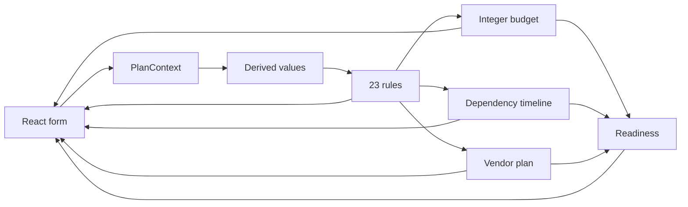

# Architecture

## Overview
Utsav is a local-first planner. The deterministic domain core computes budget,
timeline, vendors, rules, risks, and readiness in the browser. AI features are
optional enrichments layered on top in a later phase.

## Current state (P1 domain core)
- `src/engine/types.ts` defines `PlanContext`, budget lines, tasks, vendors, rules, risks, and readiness.
- `src/engine/schema.ts` validates external input with strict Zod schemas.
- `src/engine/context.ts` creates sample contexts and derives season, rush, floors, and contingency values.
- `src/engine/rules.ts` contains 23 pure rules with effects and explanations.
- `src/engine/budget.ts` allocates integer rupees with largest-remainder rounding, floors, contingency, and feasibility.
- `src/engine/timeline.ts` schedules dependency-aware tasks, compresses lead times in rush mode, and builds the day-of run-of-show.
- `src/engine/vendors.ts` selects vendor categories and attaches checklists, red flags, lead times, and Maps deep links.
- `src/engine/readiness.ts` combines task, vendor, budget, and risk signals into a 0-100 score.
- `src/engine/plan.ts` orchestrates the engines without any network call.
- `src/domain.ts` keeps the early compatibility API while delegating to the engine.
- `src/App.tsx` renders the planner, dashboard, budget health, timeline, run-of-show, vendors, risks, and "Why this plan?".

## Data flow

## Planned future layers
- `server/` Express API, Gemini provider chain, caching, rate limits, and security headers.
- Route-level client shell with i18n, themes, persistence, and export/import.
- Optional lazy-loaded Firebase Auth and Firestore sync.
